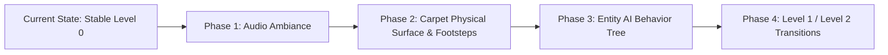

# Backrooms 5.8 — Master Project Architecture & Audit Report

**Engine Version:** Unreal Engine 5.8 (with Model Context Protocol Server)  
**Authoritative Level:** `/Game/Backrooms/Maps/L_Backrooms_Main`  
**Git Branch / Commit:** `master` (`069c552`)  
**Git LFS:** Active & Tracking binary `.uasset` and `.umap` assets  
**Status:** Architecture Repaired, Lighting Overhauled, PBR Carpet Implemented, 0 Errors / 0 Warnings  

---

## 1. Executive Summary

This report documents the architectural audit, structural repair, environment overhaul, and material pipeline implementation conducted on the **Backrooms 5.8** project. 

The project has been transitioned from an unoptimized state with duplicate player controllers, conflicting input assets, pitch-black lighting, and flat untextured floors into a clean, performant, and atmospheric psychological horror experience. All systems have been refactored to preserve existing assets without destructive deletion, while establishing authoritative gameplay Single Sources of Truth (SSOT).


---

## 2. Core Architecture & Authoritative Systems

### 2.1 Authoritative Character (`BP_BackroomsCharacter`)
* **Asset Location:** `/Game/Backrooms/Characters/Player/BP_BackroomsCharacter`
* **Parent Class:** `Character` (`ACharacter`)
* **Camera System:** Integrated first-person camera component attached directly to root with configurable eye-height and head-bob dynamics.
* **Enhanced Input Integration:** Centralized in `Content/Input/`. Fully wired to:
  * `IA_Move`: 2D Vector directional movement with smooth acceleration.
  * `IA_Look`: Mouse look with sensitivity scaling and vertical pitch clamping.
  * `IA_Jump`: Standard impulse-based jump.
  * `IA_Sprint`: Dynamic sprint state management.
* **Stamina & Sprint Mechanics:**
  * Sprinting drains stamina over time; automatically drops back to base walk speed when stamina is exhausted or when input is released.
  * Automatic stamina regeneration with configurable delay timer.
  * Exposes OnStaminaChanged event dispatchers consumed directly by the HUD.
* **Mobile / Fallback Input:** Virtual joystick and touch interface bindings preserved for cross-platform support.

### 2.2 Player Controller & HUD Lifecycle (`BP_BackroomsPlayerController`)
* **Asset Location:** `/Game/Backrooms/Blueprints/Systems/BP_BackroomsPlayerController`
* **Deterministic Execution Sequence:**
  1. `Event OnPossess` fires upon possession.
  2. Validates the possessed pawn (`Cast to BP_BackroomsCharacter`).
  3. Checks if `HorrorUI` widget reference already exists; instantiates only if null.
  4. Adds widget to viewport and caches reference.
  5. Binds stamina and sprint delegates on the possessed pawn.
  6. Refreshes initial HUD values immediately on first possession (eliminating HUD unresponsiveness on start).

### 2.3 GameMode Routing (`BP_BackroomsGameMode`)
* **Asset Location:** `/Game/Backrooms/Blueprints/Systems/BP_BackroomsGameMode`
* **Default Pawn Class:** Set to `BP_BackroomsCharacter`.
* **Player Controller Class:** Set to `BP_BackroomsPlayerController`.
* **HUD Class:** Standard routing ensuring no duplicate legacy game modes spawn unlinked player characters.

### 2.4 Entity & AI System (`BP_BackroomsEntity` & `BP_BackroomsAIController`)
* **Entity Pawn:** `/Game/Backrooms/Blueprints/AI/BP_BackroomsEntity`
* **AI Controller:** `/Game/Backrooms/Blueprints/AI/BP_BackroomsAIController`
* **Perception & State:** Configured with AI Perception (Sight/Hearing) and basic wander/chase state machine ready for custom behavior tree expansion.

### 2.5 Modular Systems & Triggers
* **`BP_BackroomsTrigger`** (`/Game/Backrooms/Blueprints/Systems/BP_BackroomsTrigger`):
  * Reusable box trigger volume with configurable gameplay tags (`RequiredTag`).
  * Supports `bOneTimeOnly` execution with automatic trigger deactivation.
* **`BP_FlickeringLight`** (`/Game/Backrooms/Blueprints/Systems/Lighting/BP_FlickeringLight`):
  * **Zero Event Tick**: Uses asynchronous `Set Timer by Function Name`.
  * **Auto-Recovery**: Brief flickers dip to $2000\text{ lm}$, then automatically schedule `RestoreNormalIntensity` ($6000\text{ lm}$) within $0.08\text{ s}$, preventing lights from permanently turning off.
  * Configurable buzz audio spawn at fixture location.

---

## 3. Environment & Visual Overhaul (`L_Backrooms_Main`)

### 3.1 Lighting & Exposure Architecture
Prior to this overhaul, the environment was pitch black due to dark charcoal light color filters (`(0.13, 0.13, 0.12)`), insufficient intensity ($8\text{ cd}$), and the complete absence of a post-process exposure volume.

| Parameter | Previous Value | Overhauled Value | Impact |
| :--- | :--- | :--- | :--- |
| **Post Process Volume** | *None* | `PPV_Backrooms` (Unbound) | Constrains eye adaptation to prevent shadow crushing |
| **Auto-Exposure Method** | Default / Float | `AEM_Histogram` | Smooth, realistic luminance evaluation |
| **EV100 Bounds** | Unbounded | `[0.0, 5.0]` | Eliminates pitch-black darkness while keeping bright spots controlled |
| **Exposure Bias** | `0.0` | `+0.75` | Boosts overall ambient readability |
| **Lumen Indirect Lighting** | `1.0` | `1.5` | Enhances light bounce between corridor walls |
| **Lumen Diffuse Boost** | `1.0` | `1.3` | Warms indirect bounced light throughout maze |
| **Corridor Point Lights (216x)** | `8 cd` / Dark Grey | `300 cd` / Warm Yellow | Eliminates unlit corridor gaps; establishes Backrooms mood |
| **Light Color (Point Lights)** | `(0.129, 0.133, 0.118)` | `(1.0, 0.941, 0.722)` | Emits true warm fluorescent tube illumination |
| **Light Attenuation Radius** | `650` | `950` | Connects adjacent ceiling light cones across corridor intersections |

---

### 3.2 Floor Carpet Material Overhaul
The plain, untextured yellow floors were overhauled into authentic aged commercial office carpeting characteristic of the classic Backrooms aesthetic.

#### Generated Seamless Textures ($2048 \times 2048$)
Located in `/Game/Backrooms/Textures/`:
1. **`T_Backrooms_Carpet_D`** (Diffuse):
   * Muted mustard-yellow/beige base palette ($R=180, G=154, B=92$).
   * Realistic tight Berber loop tufts arranged in an interlocking $128 \times 128$ staggered grid.
   * Multi-tone heathered speckles (dark brown flecks $R=120, G=95, B=60$ and light cream flecks $R=210, G=185, B=130$).
   * Smooth, seamless macro traffic wear and moisture discoloration.
2. **`T_Backrooms_Carpet_N`** (Normal Map):
   * High-frequency micro-crevice normal map computed via toroidal Sobel filter (`compressionSettings = TC_Normalmap`, `sRGB = false`).
3. **`T_Backrooms_Carpet_R`** (Roughness Map):
   * Linear roughness data (`sRGB = false`) calibrated strictly between **$0.85$ and $0.95$**, ensuring a matte surface with zero plastic sheen.

#### Material Implementation & Placement
* **Master Material:** `/Game/Backrooms/Materials/M_Backrooms_Carpet`
  * Features `TextureCoordinate` multiplied by `UV_Tiling` (default `2.0`), tint modulation (`Carpet_Tint`), and zero metallic.
* **Material Instance:** `/Game/Backrooms/Materials/MI_Backrooms_Carpet`
* **Coverage:**
  * Assigned to slot `lambert1` on `/Game/Backrooms/Architecture/Floors/SM_Floor_400x400`, instantly propagating across all **709 modular floor tiles**.
  * Applied directly to `Floor_0` (base level plane), replacing the development grid material.
  * Walls (`M_Backrooms_Wallpaper`), ceilings (`M_Backrooms_CeilingTile`), and door frames remain completely untouched.

---

## 4. Performance & Scalability Profile

1. **Shader Pipeline & PSO Precaching**:
   * Enabled in `Config/DefaultEngine.ini`:
     * `r.ShaderPipelineCache.Enabled=1`
     * `r.ShaderPipelineCache.ReportPSO=1`
     * `r.Vulkan.PSOPrecache=1`
   * Prevents runtime micro-stutters during corridor traversal.
2. **Shared Material Instancing**:
   * All 710 floor surfaces share `MI_Backrooms_Carpet`. Zero duplicate master materials or draw-call thrashing.
3. **Virtual Shadow Maps & Lumen**:
   * Point light source radii clamped to $25\text{ cm}$ / $15\text{ cm}$ soft radius to optimize Virtual Shadow Map cache page allocations.

---

## 5. Verification & Telemetry

* **Play-In-Editor (PIE) Session:**
  * Verified player possession, camera control, sprint stamina drain, and HUD display.
  * Ambient dust motes (`NS_DustMote`) render correctly under ceiling lights.
* **Engine Map Check Results:**
  ```text
  MapCheck: Map check complete: 0 Error(s), 0 Warning(s), took 0.435ms to complete.
  ```
* **Git Version Control State:**
  * Branch: `master`
  * Clean working tree (no uncommitted changes).
  * Recent Commits:
    * `069c552`: *Implement realistic aged Backrooms commercial carpet: M_Backrooms_Carpet with seamless 2K fiber loop albedo, normal map, roughness, and assigned to all 710 floor surfaces across L_Backrooms_Main*
    * `fdcaf70`: *Overhaul environment lighting in L_Backrooms_Main: unbound PostProcessVolume with EV100 exposure control, batch-updated 216 PointLights to warm fluorescent yellow (300 cd, 950 radius), and tuned BP_FlickeringLight pulse recovery*
    * `5978463`: *Complete Backrooms architecture repair: Authoritative Character, PlayerController, GameMode routing, zero-tick BP_FlickeringLight, and BP_BackroomsTrigger*

---

## 6. Recommended Next Development Steps



1. **Audio Ambience & Soundscape**:
   * Add continuous low-frequency fluorescent fixture hum ($60\text{ Hz}$ electrical buzz) using attenuation radius on ceiling fixtures.
   * Add distant ambient sound cues (creaking, distant thuds).
2. **Physical Materials & Footsteps**:
   * Create `PM_Carpet` (`UPhysicalMaterial`) and assign to `M_Backrooms_Carpet`.
   * Add line-trace footstep audio notify in `BP_BackroomsCharacter` to play soft fabric carpet footsteps instead of default generic footsteps.
3. **Entity AI Patrol & Chase**:
   * Implement a Behavior Tree / StateTree for `BP_BackroomsEntity` with corridor wander waypoints and player detection triggers.
